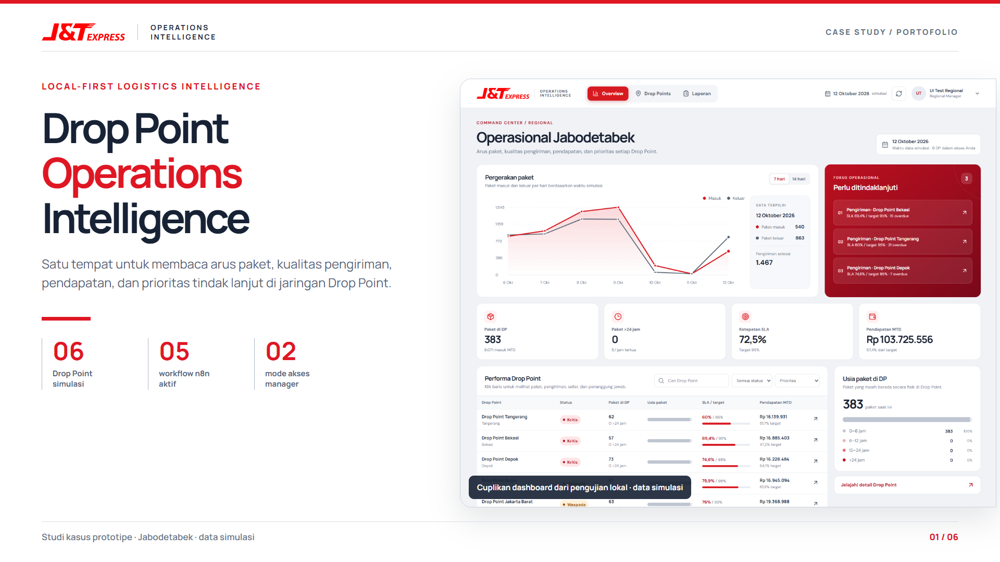

# Drop Point Operations Intelligence

Studi kasus portofolio untuk pemantauan ekspedisi berbasis **PostgreSQL, FastAPI, React, n8n, dan Telegram AI**. Sistem menggabungkan ringkasan regional, detail enam Drop Point, laporan terjadwal, alert, dan tanya jawab operasional. Prototipe ini berjalan **lokal dengan data simulasi**; ini bukan sistem produksi.



## Apa yang tersedia

- **Dashboard regional:** tren paket 7/14 hari, KPI, prioritas, usia paket, dan perbandingan antar-DP.
- **Dashboard DP Manager:** enam tab detail—Operasi, Paket, Pengiriman, Seller & Pendapatan, PIC Seller, Tim & Tanggung Jawab—dengan antrean paket dan isu lokasi.
- **Akses berbasis role:** Regional Manager melihat DP dalam grant region; DP Manager hanya DP miliknya. Pembatasan ditegakkan di API, termasuk saat URL diubah manual.
- **Otomasi n8n:** generator simulasi, laporan intraday/harian, critical alert, dan webhook Telegram AI.
- **Model data logistik:** origin/destination DP, shipment lifecycle, seller, kurir, ongkir, target, serta unit/PIC penanggung jawab.

KPI utama dihitung dari data terstruktur oleh SQL/Python. AI menjelaskan hasil dan menjawab pertanyaan Regional Manager, bukan membuat angka KPI sendiri. Telegram diakses langsung lewat bot, bukan halaman website.

## Arsitektur


PostgreSQL, FastAPI, dan n8n berjalan di Docker lokal. Frontend React/Vite berjalan pada komputer pengembang. Ngrok memberi HTTPS sementara/berdomain akun untuk webhook Telegram; laptop dan layanan lokal tetap harus menyala. GitHub Pages hanya bisa menayangkan frontend statis—API dan PostgreSQL perlu hosting terpisah jika kelak dibuka untuk publik.

## Jalankan pada instalasi lokal yang sudah berisi data

Instruksi di bawah ini ditujukan untuk laptop proyek yang **sudah memiliki database demo, `.env`, dan credential n8n**. Panduan lengkap beserta troubleshooting ada di [PANDUAN_MENJALANKAN_PROJECT.md](PANDUAN_MENJALANKAN_PROJECT.md).

**1. Nyalakan Docker Desktop**, lalu di PowerShell:

```powershell
cd 'D:\BISMILLAH DATA\Project\Data Analyst\Drop Point Operations Intelligence'
docker compose up -d --build
docker compose ps
```

Periksa `http://127.0.0.1:8000/health` (API) dan `http://127.0.0.1:5678/healthz` (n8n). Keduanya harus mengembalikan status `ok`.

**2. Jalankan webhook Telegram** di PowerShell kedua dengan domain ngrok yang sama seperti `N8N_WEBHOOK_URL` pada `.env`:

```powershell
ngrok http 5678 --url https://DOMAIN-ANDA.ngrok-free.dev
```

Biarkan jendela ini terbuka. Jika webhook perlu dipasang atau diperiksa, dari folder utama jalankan:

```powershell
.\.venv\Scripts\python.exe scripts\configure_webhook.py
.\.venv\Scripts\python.exe scripts\configure_webhook.py --check
```

Bot demo: [@drop_point_ops_bot](https://t.me/drop_point_ops_bot). Hanya chat Regional Manager yang dikonfigurasi lokal dapat meminta data regional.

**3. Jalankan dashboard** di PowerShell ketiga:

```powershell
cd frontend
npm ci
npm run dev
```

Buka `http://127.0.0.1:5173/`. `npm ci` diperlukan pada pemasangan pertama/ketika dependensi berubah; untuk hari berikutnya cukup `npm run dev`. Email demo tercantum di [frontend/DEMO_ACCOUNTS.md](frontend/DEMO_ACCOUNTS.md). Password demo ada pada `AKUN_DAN_PASSWORD_DEMO.txt` di laptop pemilik proyek dan **tidak** dimasukkan ke GitHub. Beberapa akun akan diminta mengganti password dan login ulang.

| Antarmuka | Alamat |
| --- | --- |
| Dashboard | `http://127.0.0.1:5173/` |
| FastAPI docs | `http://127.0.0.1:8000/docs` |
| n8n | `http://127.0.0.1:5678/` |
| Bot | `https://t.me/drop_point_ops_bot` |

## Jika mulai dari clone GitHub baru

1. Salin `.env.example` ke `.env`, lalu isi secret milik Anda. **Jangan commit `.env`**.
2. Siapkan Docker Desktop, Python, Node.js, ngrok, bot Telegram, dan penyedia LLM kompatibel API.
3. Siapkan data contoh dan migrasi SQL di `sql/`. Workbook sumber `data/`, volume PostgreSQL, backup, password demo, dan credential n8n **tidak disertakan** dalam repo publik. Karena itu, clone baru belum dapat langsung menampilkan enam DP tanpa provisioning data.
4. Contoh workflow yang aman untuk dibagikan ada di `n8n/workflows/`. Semua diimpor tidak aktif, tanpa credential, dan berisi placeholder untuk internal key/chat ID. Isi dan sambungkan ulang sebelum mengaktifkannya.
5. Setelah database dan credential siap, ikuti [panduan operasional](PANDUAN_MENJALANKAN_PROJECT.md).

Repositori ini memprioritaskan keterbacaan arsitektur dan kode untuk portofolio. Bootstrap data demo yang sepenuhnya publik adalah pekerjaan lanjutan.

## Struktur proyek

| Lokasi | Isi |
| --- | --- |
| `app/` | FastAPI: auth, dashboard, reporting, simulator, alert, chat |
| `sql/` | Skema, migrasi, view analitik, query verifikasi |
| `frontend/` | React/Vite dashboard dan uji browser |
| `n8n/workflows/` | Ekspor workflow publik yang disanitasi |
| `tests/` | Uji integrasi autentikasi dan batas akses |
| `docs/portfolio/` | Sumber gambar portofolio yang dapat diedit |
| `PORTOFOLIO_*.png` | Enam gambar siap dibagikan |

## Dokumentasi dan gambar portofolio

- [Panduan lengkap menjalankan sistem](PANDUAN_MENJALANKAN_PROJECT.md)
- [PRD terbaru](PRD_DROP_POINT_OPERATIONS_INTELLIGENCE.md)
- [Model database](DATABASE_MODEL.md)
- [Endpoint dashboard dan akses](docs/AUTH_DASHBOARD_API.md)
- [01 — Studi kasus](PORTOFOLIO_01_Studi_Kasus.png) · [02 — Proses](PORTOFOLIO_02_Proses_Operasional.png) · [03 — Arsitektur](PORTOFOLIO_03_Arsitektur_Sistem.png)
- [04 — Dashboard regional](PORTOFOLIO_04_Dashboard_Regional.png) · [05 — Detail DP](PORTOFOLIO_05_Detail_Drop_Point.png) · [06 — Otomasi & AI](PORTOFOLIO_06_Automasi_dan_AI.png)

Rancangan layar yang dapat diedit juga tersedia di [Figma](https://www.figma.com/design/IXMuveVYrGq41skubzCxwl). Gambar dashboard pada repo berasal dari QA aplikasi lokal dan menampilkan data simulasi.

## Validasi

Dengan API dan PostgreSQL lokal aktif:

```powershell
.\.venv\Scripts\python.exe scripts\run_local_tests.py
.\.venv\Scripts\python.exe scripts\run_local_tests.py --browser
```

Tes mencakup login, ganti password, akses lintas DP, chart, filter, enam tab detail, laporan, dan tampilan ponsel. Sebelum deployment publik, tambahkan rate limiting login, reset password, pengelolaan secret, data demo yang dapat dipublikasikan, serta hosting HTTPS terpisah untuk API/database.

Logo J&T Express dipakai pada prototipe visual ini; sumber berkas logo tercatat di [frontend/README.md](frontend/README.md). Semua metrik yang terlihat pada screenshot adalah simulasi.
