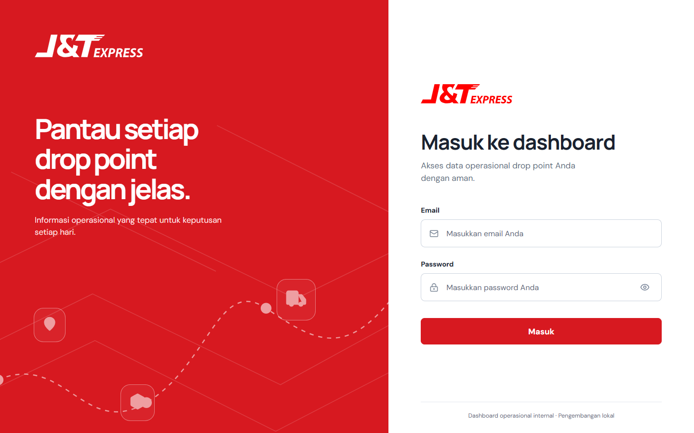
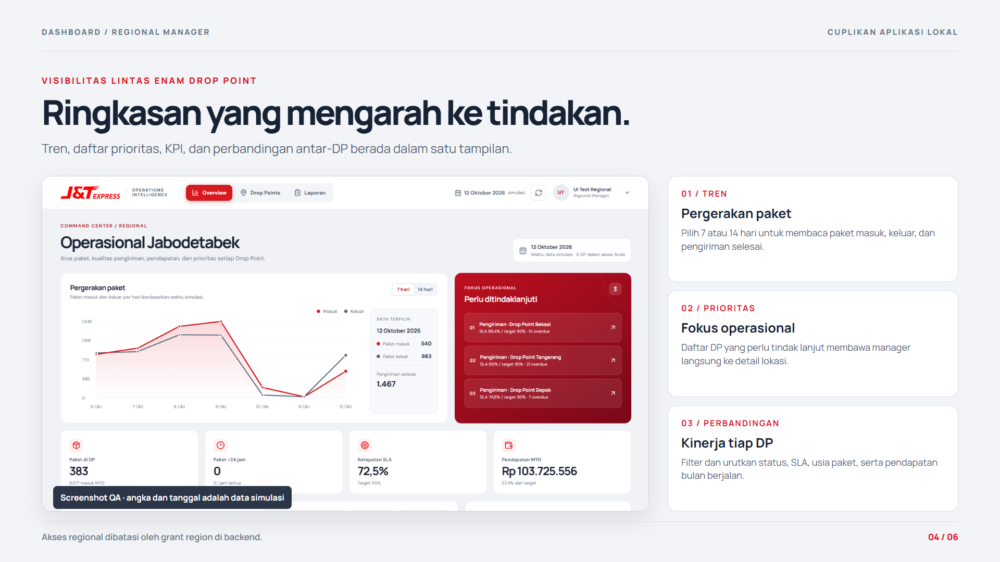
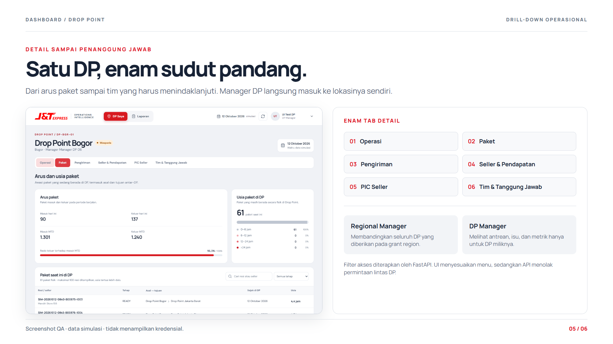
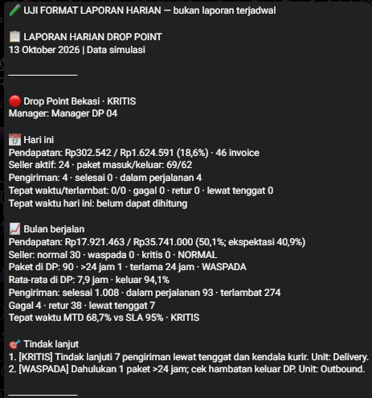
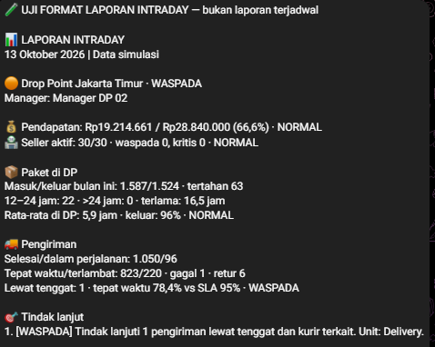
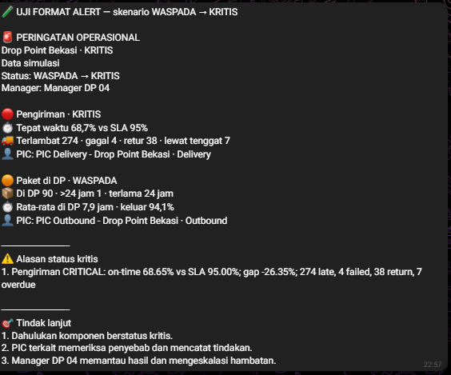

# Panduan pengguna: website dan Telegram

Panduan ini mengikuti urutan pemakaian demo lokal, dari login hingga membaca laporan Telegram. Semua angka dan tanggal operasional dalam gambar adalah **data simulasi**. Untuk menyalakan Docker, API, frontend, n8n, dan ngrok dari kondisi mati, ikuti [panduan menjalankan proyek](PANDUAN_MENJALANKAN_PROJECT.md) terlebih dahulu.

[Buka versi PDF](PANDUAN_PENGGUNA_STEP_BY_STEP.pdf)

## 1. Masuk dengan email dan password

1. Pastikan dashboard terbuka di `http://127.0.0.1:5173/` dan API sehat di `http://127.0.0.1:8000/health`.
2. Isi kolom **Email** dengan salah satu akun demo di bawah.
3. Buka `AKUN_DAN_PASSWORD_DEMO.txt` di folder utama proyek **pada laptop pemilik**. Ambil password yang cocok dengan email tersebut, lalu isi kolom **Password**. File ini tidak ada di GitHub dan tidak disalin ke PDF publik.
4. Pilih **Masuk**. Jika muncul permintaan mengganti password, isi password saat ini dan password baru, simpan, lalu login ulang. Perbarui catatan password pribadi di file lokal itu.

| Peran | Email demo |
| --- | --- |
| Regional Manager Jabodetabek | `regional.jabodetabek@demo.local` |
| DP Manager Jakarta Barat | `manager.jakarta.barat@demo.local` |
| DP Manager Jakarta Timur | `manager.jakarta.timur@demo.local` |
| DP Manager Tangerang | `manager.tangerang@demo.local` |
| DP Manager Bekasi | `manager.bekasi@demo.local` |
| DP Manager Depok | `manager.depok@demo.local` |
| DP Manager Bogor | `manager.bogor@demo.local` |

## 2. Jelajahi dashboard Regional Manager

1. Masuk memakai email regional. Halaman **Overview** merangkum DP dalam akses Jabodetabek: pergerakan paket, KPI, daftar prioritas, usia paket, dan tabel perbandingan.
2. Ubah rentang tren **7 hari / 14 hari** bila ingin melihat pola berbeda. Buka prioritas atau baris DP untuk menyelidiki lokasinya.
3. Di **Drop Points**, cari, filter, atau urutkan DP. Pilih satu DP untuk membuka enam tab detail: Operasi, Paket, Pengiriman, Seller & Pendapatan, PIC Seller, dan Tim & Tanggung Jawab.
4. Di **Laporan**, gunakan filter dan unduh CSV jika perlu data tabel. Hasilnya hanya memuat DP yang diizinkan oleh grant akun regional.

## 3. Jelajahi dashboard DP Manager

1. Logout dari akun regional, lalu masuk dengan salah satu email DP. Misalnya, akun Bogor akan membuka **DP Saya** untuk Drop Point Bogor.
2. Buka tab **Operasi** untuk melihat ringkasan; **Paket** untuk arus, umur, dan antrean; **Pengiriman** untuk SLA dan isu; **Seller & Pendapatan** serta **PIC Seller** untuk performa seller; **Tim & Tanggung Jawab** untuk pemilik tindak lanjut.
3. Gunakan pencarian pada antrean paket atau isu untuk menelusuri resi, seller, alasan, dan PIC. Di **Laporan**, data tetap terbatas pada DP milik akun tersebut.

DP Manager tidak melihat Overview regional atau daftar semua DP. API juga menolak permintaan detail DP lain walaupun alamat URL diubah manual.

## 4. Gunakan Telegram sebagai Regional Manager

1. Pastikan Docker/n8n hidup, tunnel ngrok aktif, dan webhook Telegram menunjuk ke domain yang benar. Langkah pemeriksaannya ada di [panduan operasional](PANDUAN_MENJALANKAN_PROJECT.md#2-buka-jalur-telegram).
2. Dari akun Telegram Regional Manager yang sudah didaftarkan secara lokal, buka [bot Drop Point Operations Intelligence](https://t.me/drop_point_ops_bot).
3. Kirim pertanyaan, misalnya `Beri insight dan solusi dari laporan harian` atau `Analisis laporan untuk DP Tangerang`. Bot memakai data internal dalam akses regional; ia tidak mencari informasi di web.
4. Baca laporan otomatis dan alert di chat yang sama. Bot tidak dipakai oleh akun DP Manager dan tidak ada kode penghubung ke website.

## 5. Baca laporan harian, intraday, dan alert

| Pesan | Isi yang perlu diperiksa | Jadwal konfigurasi lokal terakhir |
| --- | --- | --- |
| Laporan intraday | Status enam DP, total operasional, rincian DP perlu perhatian, insight dan tindakan | 10.00, 12.00, 14.00, 16.00 WIB pada hari kerja |
| Laporan harian | Hasil hari ini, bulan berjalan, rincian DP, insight dan tindakan | 17.05 WIB pada hari kerja |
| Critical alert | Perubahan status, komponen kritis, alasan, PIC, tindak lanjut | Pemeriksaan tiap 5 menit mulai menit 02 pada jam kerja |

Jadwal tersebut adalah konfigurasi yang terakhir didokumentasikan, bukan jaminan bahwa laptop, tunnel, atau workflow sedang aktif saat panduan dibaca. Screenshot berikut adalah **uji format dengan data simulasi**, bukan pesan yang dipicu jadwal.

## 6. Jika sesuatu tidak tampil

| Gejala | Langkah pertama |
| --- | --- |
| Website tidak terbuka | Periksa proses frontend dan alamat `127.0.0.1:5173` |
| Login gagal | Cocokkan email dengan password terbaru pada file lokal; periksa API dan PostgreSQL |
| Data dashboard kosong | Periksa `http://127.0.0.1:8000/health` dan status Docker; pastikan grant akun masih aktif |
| Bot tidak menjawab | Periksa n8n, ngrok, webhook, dan apakah pesan berasal dari chat regional yang didaftarkan |
| Laporan tidak masuk | Periksa riwayat eksekusi workflow n8n pada jam jadwal serta koneksi Telegram |

Rincian pemecahan masalah dan cara menutup layanan ada di [panduan menjalankan proyek](PANDUAN_MENJALANKAN_PROJECT.md). Detail batas akses dan endpoint ada di [dokumentasi API](AUTH_DASHBOARD_API.md). Versi PDF panduan ini berada di folder yang sama.
