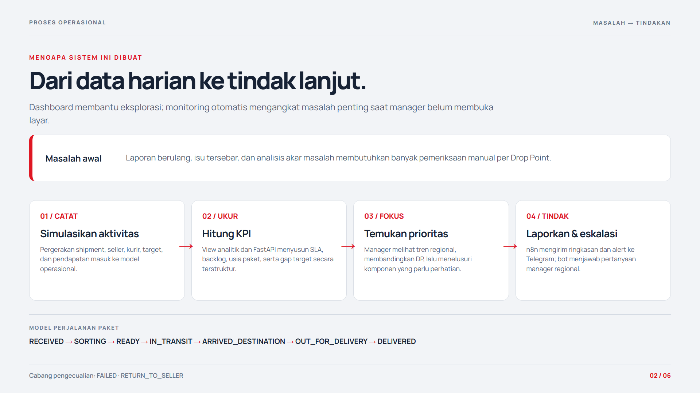
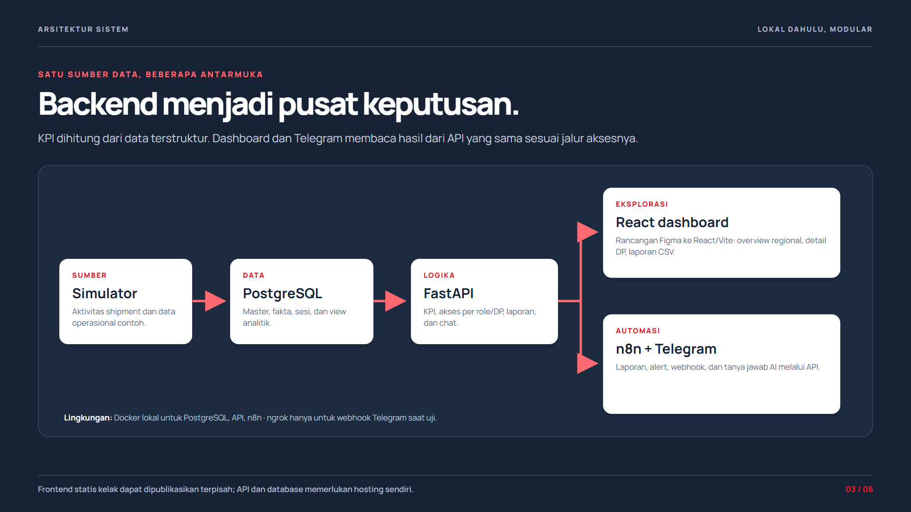
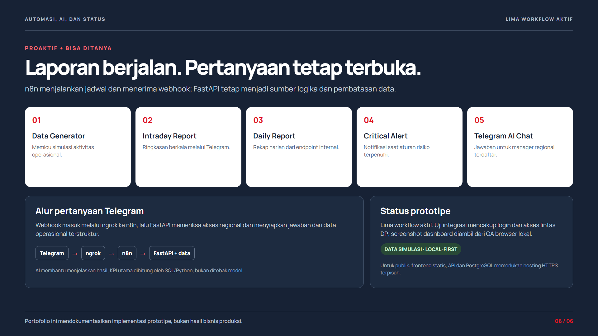

# Sistem dan alur operasional

Drop Point Operations Intelligence adalah studi kasus sistem pemantauan ekspedisi lokal dengan enam Drop Point simulasi di Jabodetabek. Dashboard memberi gambaran regional dan rincian per DP; n8n mengirim laporan/alert; bot Telegram menjawab pertanyaan Regional Manager dari data yang sama.

## Alur paket dan data

Seller menyerahkan paket ke **origin Drop Point**. Parcel melalui `RECEIVED → SORTING → READY → IN_TRANSIT → ARRIVED_DESTINATION → OUT_FOR_DELIVERY → DELIVERED`; `FAILED` dan `RETURN_TO_SELLER` adalah akhir pengecualian. **Destination Drop Point** bertanggung jawab pada sisi tujuan dan last mile. Revenue dalam model adalah ongkos kirim per invoice, bukan nilai barang atau COD. Rincian tabel, view, dan tanggung jawab unit ada di [model database](DATABASE_MODEL.md).

Simulator memperbarui data operasional lokal pada jadwal kerja. PostgreSQL menyimpan fakta dan view analitik; FastAPI menyajikan KPI dan data detail. Nilai KPI dihitung oleh SQL/Python. AI memakai sinyal yang telah dihitung untuk menyusun insight dan saran tindakan, sehingga tidak menjadi sumber angka KPI.

## Dashboard dan peran

Regional Manager melihat overview, membandingkan enam DP sesuai grant region, membuka detail DP, dan membaca laporan. DP Manager langsung diarahkan ke DP miliknya. API memeriksa sesi dan grant pada setiap permintaan; mengubah URL tidak memperluas akses. Login, ganti password, dan daftar endpoint dijelaskan di [API dan hak akses](AUTH_DASHBOARD_API.md).

Overview memuat KPI, tren harian, prioritas, usia paket, dan perbandingan DP. Detail DP mempunyai enam tab: Operasi, Paket, Pengiriman, Seller & Pendapatan, PIC Seller, serta Tim & Tanggung Jawab. Antrean paket, isu, status, asal/tujuan, dan unit/PIC membantu manager bergerak dari ringkasan ke tindakan. Laporan dapat difilter dan diunduh sebagai CSV sesuai akses.

## Otomasi dan Telegram

Lima workflow n8n lokal menangani generator data, laporan intraday, laporan harian, critical alert, dan webhook chat Telegram. Laporan serta alert masuk langsung ke chat Regional Manager yang dikonfigurasi lokal. Bot tidak menjadi halaman website dan tidak memakai kode penghubung. Detail jadwal, format, dan hasil uji ada di [Telegram dan reporting](TELEGRAM_DAN_REPORTING.md); langkah membuka layanan ada di [panduan menjalankan proyek](PANDUAN_MENJALANKAN_PROJECT.md).

Contoh hasil Telegram dari chat uji tersedia bersama gambar website: [laporan harian](images/telegram/TELEGRAM_01_Laporan_Harian.png), [laporan intraday](images/telegram/TELEGRAM_02_Intraday.png), dan [alert](images/telegram/TELEGRAM_03_Alert.png). Ketiganya memakai data simulasi dan diberi label uji format.

## Batas prototipe

Docker menjalankan PostgreSQL, FastAPI, dan n8n; frontend Vite berjalan pada host lokal. Ngrok memberi HTTPS untuk webhook Telegram dan hanya aktif selama tunnel serta laptop hidup. Repo publik tidak membawa volume database, workbook sumber, secret, atau password. GitHub Pages kelak hanya dapat menayangkan frontend statis; API dan database membutuhkan hosting terpisah. Lihat [PRD](PRD_DROP_POINT_OPERATIONS_INTELLIGENCE.md) untuk kebutuhan dan pekerjaan sebelum produksi.
